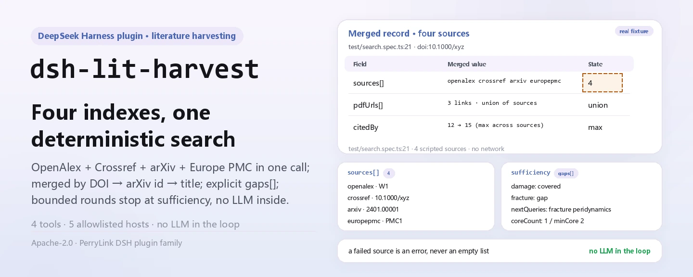
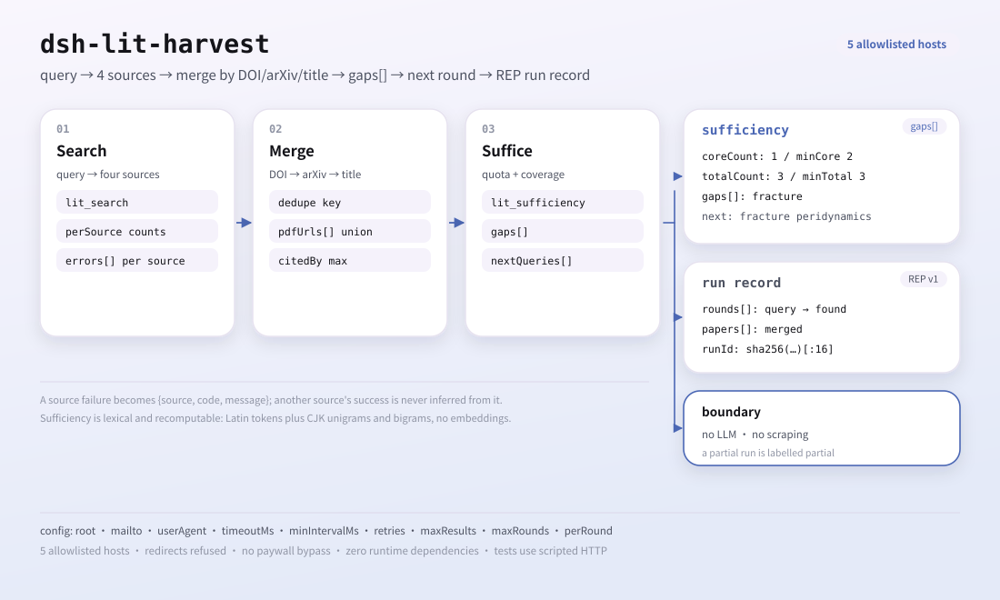
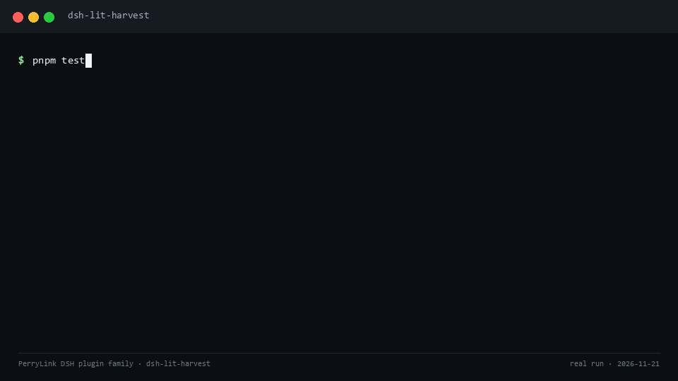

<div align="center">

<picture>
  <source media="(prefers-color-scheme: dark)" srcset="docs/assets/dsh-lit-harvest-hero-en-dark.webp">
  
</picture>

# dsh-lit-harvest

**Busca en cuatro índices, resuelve PDFs de acceso abierto y detente cuando la evidencia es suficiente — de forma determinista.**

*OpenAlex + Crossref + arXiv + Europe PMC en una sola llamada, Unpaywall para enlaces OA, cuota + cobertura de subtemas con gaps explícitos, y un bucle de recolección acotado cuyo registro de ejecución aterriza en REP. Sin LLM en el bucle, sin scraping, sin saltarse paywalls.*

[English](README.md) · [简体中文](README-zh.md) · [Español](README-es.md) · [Português](README-pt.md) · [हिन्दी](README-hi.md)

[](LICENSE)
[]()
[](https://github.com/topics/dsh-plugin)

</div>

---

## Qué hace

| Herramienta | Trabajo |
|---|---|
| `lit_search` | Despliega la búsqueda a los orígenes pedidos, deduplica por DOI → arXiv id → título normalizado, fusiona campos de origen/PDF y reporta errores por origen |
| `lit_resolve_oa` | Conserva los enlaces que un origen ya dio; busca DOIs en Unpaywall (requiere `mailto`); reporta fallos por ítem |
| `lit_sufficiency` | Cuota (core/total) + cobertura de subtemas sobre título/abstract/keywords, unigramas + bigramas CJK; devuelve `gaps[]` y `nextQueries[]` |
| `lit_harvest_run` | Bucle acotado: búsqueda → suficiencia → siguiente ronda guiada por gaps; se detiene al alcanzar suficiencia o `maxRounds`; persiste un registro de ejecución |

Cada hit lleva su origen, su id de origen, `fetchedAt` y la query que lo encontró. Un fallo de un origen se reporta como `{source, code, message}` y nunca se convierte en un conjunto de resultados vacío.


<picture>
  <source media="(prefers-color-scheme: dark)" srcset="docs/assets/dsh-lit-harvest-flow-v5-dark.svg">
  
</picture>

*Estructura: búsqueda → fusión → suficiencia; `sufficiency` y el registro de ejecución son las dos salidas, y `lit_harvest_run` sigue iterando hasta que la cuota y la cobertura de subtemas se satisfacen o se alcanza `maxRounds`. Las etiquetas dentro del diagrama son los nombres reales de herramientas y campos, así que la misma imagen sirve para los cinco idiomas.*

## Fuentes de datos

| Origen | Query | Enlace OA |
|---|---|---|
| OpenAlex | `api.openalex.org/works` | `best_oa_location.pdf_url` |
| Crossref | `api.crossref.org/works` | solo landing page |
| arXiv | `export.arxiv.org/api/query` | `link[title=pdf]` |
| Europe PMC | `www.ebi.ac.uk/europepmc/rest/search` | PDF de `fullTextUrlList` |
| Unpaywall | `api.unpaywall.org/v2/{doi}` | `best_oa_location` + `oa_locations` |

Solo se permiten estos cinco hosts. Se rechazan las redirecciones, los timeouts son explícitos y las peticiones se serializan por host con un intervalo.

## Instalación

```sh
dsh plugin --profile <name> add dsh-lit-harvest
dsh --profile <name> --dump-config | grep dsh-lit-harvest
```

Configura una dirección de contacto antes de resolver DOIs:

```yaml
mailto: you@example.org
```

`mailto` es opcional para la búsqueda (OpenAlex/Crossref solo pierden el beneficio del polite pool) y **obligatorio** para las búsquedas de DOI en Unpaywall; si falta, es un resultado tipado `MAILTO_REQUIRED`, no una lista de enlaces vacía silenciosa.

## Registro de recolección

`lit_harvest_run` persiste una instantánea JSON por ejecución:

```text
topic, subtopics, generatedAt, plugin/version, settings,
rounds[{round, query, found, newPapers, sufficient, gaps, perSource, errors}],
papers[] (merged, deduplicated),
sufficiency{coreCount, totalCount, minCore, minTotal, coverage[], gaps[], nextQueries[]}
```

- `ctx.researchEvidence` montado → un elemento de evidencia REP (tipo de medio `application/json`) con una comprobación `source-status`.
- No montado → `<root>/runs/<runId>.json` (por defecto `.lit-harvest`).
- `persist: false` → no se escribe nada.

El run id es `sha256(topic, subtopics, queries, paper identifiers)[:16]`, así que repetir la misma búsqueda produce el mismo id.

## Qué no hace

- **Sin juicio de relevancia por LLM.** Cuota, cobertura y gaps son léxicos y recalculables; el reranking semántico queda fuera de alcance.
- **Sin descarga ni parseo de texto completo.** Eso es `dsh-doc-anchor`; este plugin devuelve enlaces.
- **Sin scraping de CNKI.** La literatura china pasa por las exportaciones de `dsh-source-cnki`.
- **Sin saltarse paywalls.** Solo los enlaces OA que los proveedores exponen.
- **Sin comprobación de retractaciones.** Eso es `dsh-retraction-watch`.
- **Sin reparación silenciosa.** Un origen fallido queda en `errors[]`; una ejecución parcial se etiqueta como parcial.

## Compatibilidad

| | |
|---|---|
| DeepSeek Harness | `dsh-v0.2.2-rc.4` (verificado en esta máquina) — línea peer `>=0.2.1-0 <0.3.0 \|\| >=0.2.2-0 <0.3.0` |
| Node | `^22.19.0 \|\| >=24.9.0` (probado en `24.22.1`), solo ESM |
| Peers | `@perrylink/dsh-research-core ^0.1.0`, `@deepseek-ai/cordis ^4.0.5-alpha.1`, `@deepseek-ai/dsh-tools`, `@deepseek-ai/schemastery ^3.18.5-alpha.1` |
| Dependencias en tiempo de ejecución | **cero** |

## Configuración

| Clave | Valor por defecto | Significado |
|---|---|---|
| `enabled` | `true` | `false` no monta nada |
| `root` | `.lit-harvest` | raíz de respaldo para los registros de ejecución |
| `mailto` | — | contacto del polite pool; obligatorio para Unpaywall |
| `userAgent` | `dsh-lit-harvest/0.1.0 (…)` | se envía a cada origen |
| `timeoutMs` | `15000` | plazo por petición |
| `minIntervalMs` | `150` | intervalo por host |
| `retries` | `1` | reintentos para 429/503 |
| `maxResults` | `25` | tope por origen para `lit_search` |
| `maxRounds` / `perRound` | `3` / `10` | límites del bucle de recolección |
| `minCore` / `minTotal` | `5` / `10` | cuotas por defecto |

## Desarrollo



*Animado: la salida real de `pnpm test` el 2026-11-21 (6 archivos de prueba, 22 pruebas, HTTP con guion — sin red). El plugin no tiene CLI, así que su propia suite es la ejecución — cuatro orígenes parseados, un DOI fusionado, gaps y el registro de ejecución.*


```sh
pnpm install
pnpm run check:lockfile
pnpm typecheck
pnpm test
pnpm build
pnpm verify:package
```

El lockfile se commitea exactamente como lo escribe `pnpm install --lockfile-only` (dos documentos: el documento del gestor de paquetes de pnpm y después el documento del proyecto), así que una instalación local no lo reescribe. `pnpm run check:lockfile` falla cuando el lockfile se desvía de `package.json` o pierde esa forma.

Las pruebas usan un cliente HTTP con guion y fixtures inline; no hace falta red.

## Licencia

Apache-2.0. Ver [LICENSE](LICENSE).
