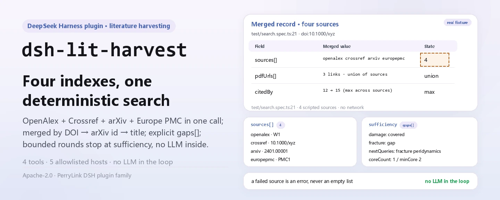
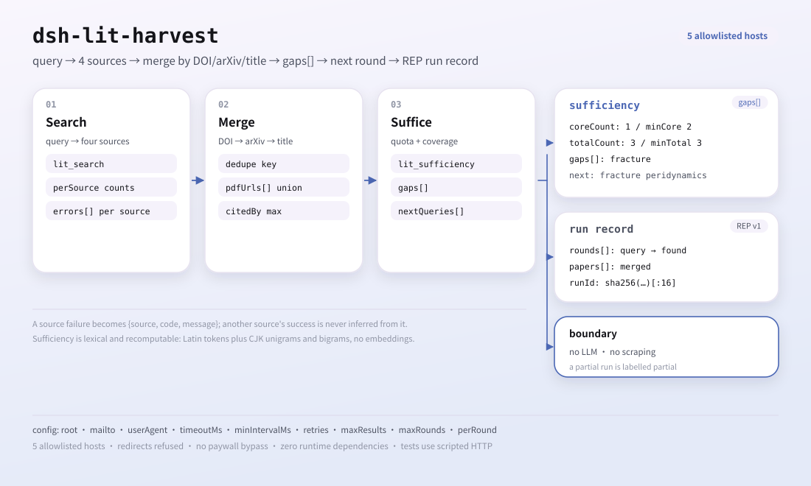
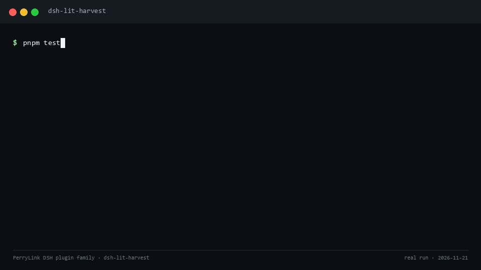

<div align="center">

<picture>
  <source media="(prefers-color-scheme: dark)" srcset="docs/assets/dsh-lit-harvest-hero-en-dark.webp">
  
</picture>

# dsh-lit-harvest

**चार इंडेक्स खोजें, open-access PDFs resolve करें, और जब प्रमाण पर्याप्त हो तो रुकें — पूरी तरह deterministic।**

*OpenAlex + Crossref + arXiv + Europe PMC एक ही कॉल में, OA links के लिए Unpaywall, स्पष्ट gaps के साथ quota + subtopic coverage, और एक सीमित harvest loop जिसका run record REP में जाता है। loop में कोई LLM नहीं, कोई scraping नहीं, paywall bypass नहीं।*

[English](README.md) · [简体中文](README-zh.md) · [Español](README-es.md) · [Português](README-pt.md) · [हिन्दी](README-hi.md)

[](LICENSE)
[]()
[](https://github.com/topics/dsh-plugin)

</div>

---

## यह क्या करता है

| टूल | काम |
|---|---|
| `lit_search` | मांगे गए स्रोतों पर खोज फैलाता है, DOI → arXiv id → सामान्यीकृत शीर्षक से dedupe करता है, source/PDF fields merge करता है, प्रति-स्रोत errors बताता है |
| `lit_resolve_oa` | स्रोत ने जो links पहले ही दिए उन्हें रखता है; Unpaywall में DOIs खोजता है (`mailto` आवश्यक); प्रति-item विफलताएँ बताता है |
| `lit_sufficiency` | शीर्षक/abstract/keywords पर quota (core/total) + subtopic coverage, CJK unigrams + bigrams; `gaps[]` और `nextQueries[]` लौटाता है |
| `lit_harvest_run` | सीमित loop: search → sufficiency → gaps-चालित अगला round; sufficiency या `maxRounds` पर रुकता है; एक run record persist करता है |

हर hit अपना source, source id, `fetchedAt` और उसे खोजने वाली query साथ रखता है। किसी स्रोत की विफलता `{source, code, message}` के रूप में दर्ज होती है और कभी खाली परिणाम-समुच्चय नहीं बनती।


<picture>
  <source media="(prefers-color-scheme: dark)" srcset="docs/assets/dsh-lit-harvest-flow-v5-dark.svg">
  
</picture>

*संरचना: search → merge → suffice; `sufficiency` और run record दो outputs हैं, और `lit_harvest_run` तब तक दोहराता है जब तक quota व subtopic coverage संतुष्ट न हों या `maxRounds` न पहुँच जाए। आरेख के भीतर के लेबल असली tool और field नाम हैं, इसलिए एक ही चित्र पाँचों भाषाओं के लिए है।*

## डेटा स्रोत

| स्रोत | Query | OA link |
|---|---|---|
| OpenAlex | `api.openalex.org/works` | `best_oa_location.pdf_url` |
| Crossref | `api.crossref.org/works` | केवल landing page |
| arXiv | `export.arxiv.org/api/query` | `link[title=pdf]` |
| Europe PMC | `www.ebi.ac.uk/europepmc/rest/search` | `fullTextUrlList` का PDF |
| Unpaywall | `api.unpaywall.org/v2/{doi}` | `best_oa_location` + `oa_locations` |

केवल यही पाँच hosts अनुमत हैं। redirects अस्वीकार होते हैं, timeouts स्पष्ट हैं, और requests हर host के लिए अंतराल के साथ क्रमबद्ध होती हैं।

## इंस्टॉल

```sh
dsh plugin --profile <name> add dsh-lit-harvest
dsh --profile <name> --dump-config | grep dsh-lit-harvest
```

DOIs resolve करने से पहले संपर्क पता सेट करें:

```yaml
mailto: you@example.org
```

`mailto` खोज के लिए वैकल्पिक है (OpenAlex/Crossref बस polite pool का लाभ खो देते हैं) और Unpaywall DOI lookups के लिए **आवश्यक** है; न होने पर यह typed `MAILTO_REQUIRED` परिणाम है, चुपचाप खाली link सूची नहीं।

## हार्वेस्ट रिकॉर्ड

`lit_harvest_run` प्रति run एक JSON snapshot persist करता है:

```text
topic, subtopics, generatedAt, plugin/version, settings,
rounds[{round, query, found, newPapers, sufficient, gaps, perSource, errors}],
papers[] (merged, deduplicated),
sufficiency{coreCount, totalCount, minCore, minTotal, coverage[], gaps[], nextQueries[]}
```

- `ctx.researchEvidence` mounted → `source-status` check के साथ एक REP evidence item (media type `application/json`)।
- mounted नहीं → `<root>/runs/<runId>.json` (डिफ़ॉल्ट `.lit-harvest`)।
- `persist: false` → कुछ भी नहीं लिखा जाता।

run id `sha256(topic, subtopics, queries, paper identifiers)[:16]` है, इसलिए वही खोज दोहराने पर वही id मिलती है।

## यह क्या नहीं करता

- **LLM से relevance का फ़ैसला नहीं।** quota, coverage और gaps lexical तथा पुनर्गणनीय हैं; semantic reranking दायरे से बाहर है।
- **full-text download या parsing नहीं।** वह `dsh-doc-anchor` का काम है; यह plugin केवल links देता है।
- **CNKI scraping नहीं।** चीनी साहित्य `dsh-source-cnki` के exports से आता है।
- **paywall bypass नहीं।** केवल वे OA links जो providers खुद देते हैं।
- **retraction जाँच नहीं।** वह `dsh-retraction-watch` का काम है।
- **चुपचाप सुधार नहीं।** विफल स्रोत `errors[]` में रहता है; आंशिक run आंशिक के रूप में चिह्नित होती है।

## अनुकूलता

| | |
|---|---|
| DeepSeek Harness | `dsh-v0.2.2-rc.4` (इस मशीन पर सत्यापित) — peer line `>=0.2.1-0 <0.3.0 \|\| >=0.2.2-0 <0.3.0` |
| Node | `^22.19.0 \|\| >=24.9.0` (`24.22.1` पर परीक्षित), केवल ESM |
| Peers | `@perrylink/dsh-research-core ^0.1.0`, `@deepseek-ai/cordis ^4.0.5-alpha.1`, `@deepseek-ai/dsh-tools`, `@deepseek-ai/schemastery ^3.18.5-alpha.1` |
| runtime dependencies | **शून्य** |

## कॉन्फ़िगरेशन

| Key | डिफ़ॉल्ट | अर्थ |
|---|---|---|
| `enabled` | `true` | `false` होने पर कुछ भी mount नहीं होता |
| `root` | `.lit-harvest` | run records के लिए fallback जड़ |
| `mailto` | — | polite pool संपर्क; Unpaywall के लिए आवश्यक |
| `userAgent` | `dsh-lit-harvest/0.1.0 (…)` | हर स्रोत को भेजा जाता है |
| `timeoutMs` | `15000` | प्रति request समय-सीमा |
| `minIntervalMs` | `150` | प्रति host अंतराल |
| `retries` | `1` | 429/503 के लिए पुनः प्रयास |
| `maxResults` | `25` | `lit_search` का प्रति-स्रोत टोप |
| `maxRounds` / `perRound` | `3` / `10` | harvest loop की सीमाएँ |
| `minCore` / `minTotal` | `5` / `10` | डिफ़ॉल्ट quotas |

## डेवलपमेंट



*एनिमेटेड: 2026-11-21 की असली `pnpm test` output (6 टेस्ट फ़ाइलें, 22 टेस्ट, scripted HTTP — कोई नेटवर्क नहीं)। इस plugin का CLI नहीं है, इसलिए उसका अपना suite ही वह रन है — चार स्रोत parse हुए, एक DOI merge हुआ, gaps और run record।*


```sh
pnpm install
pnpm run check:lockfile
pnpm typecheck
pnpm test
pnpm build
pnpm verify:package
```

lockfile ठीक वैसे ही commit होता है जैसे `pnpm install --lockfile-only` उसे लिखता है (दो दस्तावेज़: pnpm का अपना package-manager दस्तावेज़, फिर project दस्तावेज़), इसलिए स्थानीय install उसे दोबारा नहीं लिखता। `pnpm run check:lockfile` तब विफल होता है जब lockfile `package.json` से हट जाए या वह रूप खो दे।

टेस्ट scripted HTTP client और inline fixtures का उपयोग करते हैं; किसी नेटवर्क की आवश्यकता नहीं।

## लाइसेंस

Apache-2.0. देखें [LICENSE](LICENSE).
