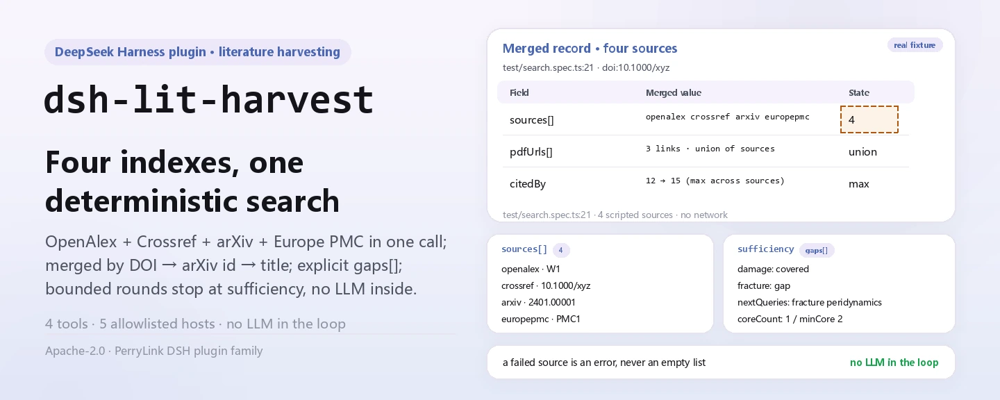
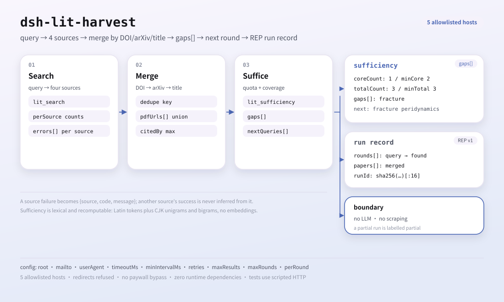
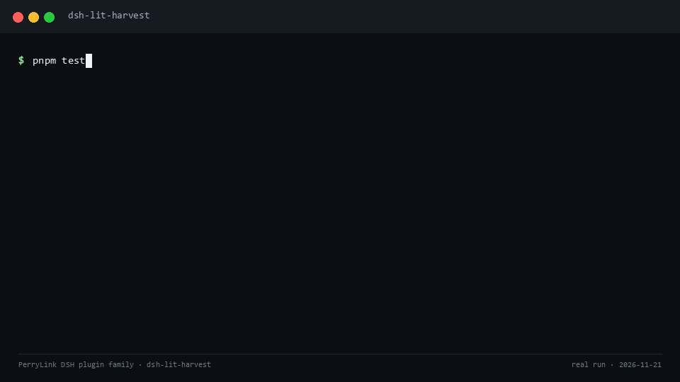

<div align="center">

<picture>
  <source media="(prefers-color-scheme: dark)" srcset="docs/assets/dsh-lit-harvest-hero-en-dark.webp">
  
</picture>

# dsh-lit-harvest

**Pesquise em quatro índices, resolva PDFs de acesso aberto e pare quando a evidência for suficiente — de forma determinística.**

*OpenAlex + Crossref + arXiv + Europe PMC em uma só chamada, Unpaywall para links OA, cota + cobertura de subtemas com gaps explícitos, e um laço de coleta limitado cujo registro de execução cai no REP. Sem LLM no laço, sem scraping, sem burlar paywalls.*

Última verificação: DeepSeek Harness `dsh-v0.2.3-alpha.1` (2026-11-22).

[English](README.md) · [简体中文](README-zh.md) · [Español](README-es.md) · [Português](README-pt.md) · [हिन्दी](README-hi.md)

[](LICENSE)
[]()
[](https://github.com/topics/dsh-plugin)

</div>

---

## O que ele faz

| Ferramenta | Trabalho |
|---|---|
| `lit_search` | Distribui a busca pelos origens pedidos, deduplica por DOI → arXiv id → título normalizado, funde campos de origem/PDF e reporta erros por origem |
| `lit_resolve_oa` | Mantém os links que a origem já deu; consulta DOIs no Unpaywall (exige `mailto`); reporta falhas por item |
| `lit_sufficiency` | Cota (core/total) + cobertura de subtemas sobre título/abstract/keywords, unigramas + bigramas CJK; devolve `gaps[]` e `nextQueries[]` |
| `lit_harvest_run` | Laço limitado: busca → suficiência → próxima rodada guiada por gaps; para na suficiência ou em `maxRounds`; persiste um registro de execução |

Cada hit carrega sua origem, o id na origem, `fetchedAt` e a query que o encontrou. A falha de uma origem é reportada como `{source, code, message}` e nunca vira um conjunto de resultados vazio.

<picture>
  <source media="(prefers-color-scheme: dark)" srcset="docs/assets/dsh-lit-harvest-flow-v5-dark.svg">
  
</picture>

*Estrutura: busca → fusão → suficiência; `sufficiency` e o registro de execução são as duas saídas, e `lit_harvest_run` continua iterando até a cota e a cobertura de subtemas serem satisfeitas ou `maxRounds` ser atingido. Os rótulos dentro do diagrama são os nomes reais de ferramentas e campos, então a mesma imagem serve aos cinco idiomas.*

## Fontes de dados

| Origem | Query | Link OA |
|---|---|---|
| OpenAlex | `api.openalex.org/works` | `best_oa_location.pdf_url` |
| Crossref | `api.crossref.org/works` | apenas landing page |
| arXiv | `export.arxiv.org/api/query` | `link[title=pdf]` |
| Europe PMC | `www.ebi.ac.uk/europepmc/rest/search` | PDF de `fullTextUrlList` |
| Unpaywall | `api.unpaywall.org/v2/{doi}` | `best_oa_location` + `oa_locations` |

Apenas esses cinco hosts são permitidos. Redirecionamentos são recusados, os timeouts são explícitos e as requisições são serializadas por host com um intervalo.

## Instalação

```sh
dsh plugin --profile <name> add dsh-lit-harvest
dsh --profile <name> --dump-config | grep dsh-lit-harvest
```

Configure um endereço de contato antes de resolver DOIs:

```yaml
mailto: you@example.org
```

`mailto` é opcional para a busca (OpenAlex/Crossref apenas perdem o benefício do polite pool) e **obrigatório** para as consultas de DOI no Unpaywall; se faltar, é um resultado tipado `MAILTO_REQUIRED`, não uma lista silenciosamente vazia de links.

## Registro de coleta

`lit_harvest_run` persiste um snapshot JSON por execução:

```text
topic, subtopics, generatedAt, plugin/version, settings,
rounds[{round, query, found, newPapers, sufficient, gaps, perSource, errors}],
papers[] (merged, deduplicated),
sufficiency{coreCount, totalCount, minCore, minTotal, coverage[], gaps[], nextQueries[]}
```

- `ctx.researchEvidence` montado → um item de evidência REP (tipo de mídia `application/json`) com uma checagem `source-status`.
- Não montado → `<root>/runs/<runId>.json` (padrão `.lit-harvest`).
- `persist: false` → nada é escrito.

O run id é `sha256(topic, subtopics, queries, paper identifiers)[:16]`, então repetir a mesma busca produz o mesmo id.

## O que ele não faz

- **Sem julgamento de relevância por LLM.** Cota, cobertura e gaps são léxicos e recalculáveis; o reranking semântico fica fora de escopo.
- **Sem download nem parsing de texto completo.** Isso é `dsh-doc-anchor`; este plugin devolve links.
- **Sem scraping de CNKI.** A literatura chinesa passa pelas exportações do `dsh-source-cnki`.
- **Sem burlar paywalls.** Apenas os links OA que os provedores expõem.
- **Sem checagem de retratações.** Isso é `dsh-retraction-watch`.
- **Sem reparo silencioso.** Uma origem com falha fica em `errors[]`; uma execução parcial é rotulada como parcial.

## Compatibilidade

| | |
|---|---|
| DeepSeek Harness | `dsh-v0.2.2-rc.4` (verificado nesta máquina) — linha peer `>=0.2.1-0 <0.3.0 \|\| >=0.2.2-0 <0.3.0` |
| Node | `^22.19.0 \|\| >=24.9.0` (testado em `24.22.1`), apenas ESM |
| Peers | `@perrylink/dsh-research-core ^0.1.0`, `@deepseek-ai/cordis ^4.0.5-alpha.1`, `@deepseek-ai/dsh-tools`, `@deepseek-ai/schemastery ^3.18.5-alpha.1` |
| Dependências em tempo de execução | **zero** |

## Configuração

| Chave | Padrão | Significado |
|---|---|---|
| `enabled` | `true` | `false` não monta nada |
| `root` | `.lit-harvest` | raiz de fallback para os registros de execução |
| `mailto` | — | contato do polite pool; obrigatório para o Unpaywall |
| `userAgent` | `dsh-lit-harvest/0.1.0 (…)` | enviado a cada origem |
| `timeoutMs` | `15000` | prazo por requisição |
| `minIntervalMs` | `150` | intervalo por host |
| `retries` | `1` | novas tentativas para 429/503 |
| `maxResults` | `25` | teto por origem para `lit_search` |
| `maxRounds` / `perRound` | `3` / `10` | limites do laço de coleta |
| `minCore` / `minTotal` | `5` / `10` | cotas padrão |

## Desenvolvimento



*Animado: a saída real de `pnpm test` em 2026-11-21 (6 arquivos de teste, 22 testes, HTTP com script — sem rede). O plugin não tem CLI, então a própria suíte é a execução — quatro origens parseadas, um DOI fundido, gaps e o registro de execução.*

```sh
pnpm install
pnpm run check:lockfile
pnpm typecheck
pnpm test
pnpm build
pnpm verify:package
```

O lockfile é commitado exatamente como `pnpm install --lockfile-only` o escreve (dois documentos: o documento do gerenciador de pacotes do pnpm e depois o documento do projeto), então uma instalação local não o reescreve. `pnpm run check:lockfile` falha quando o lockfile se desvia do `package.json` ou perde essa forma.

Os testes usam um cliente HTTP com script e fixtures inline; nenhuma rede é necessária.

## Licença

Apache-2.0. Ver [LICENSE](LICENSE).
